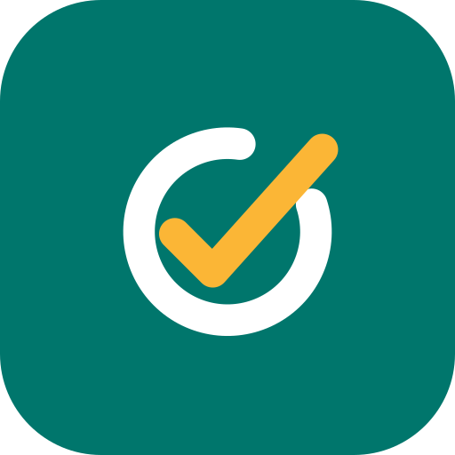
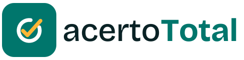

# Manual da marca acertoTotal

> **Contas a receber, acertadas.**

Este manual explica o que é a marca, de onde vem cada cor e cada forma, e como usar. Os arquivos ficam em `marca/`, e as cores, nos tokens do protótipo (`prototipo/acertototal.html`, bloco `:root`) e no Android (`android/app/src/main/res/values/themes.xml`).

## 1. A ideia

Uma conta a receber é um **ciclo aberto**: alguém vendeu, alguém deve. O app existe para **fechar esse ciclo**. O nome já diz: *acerto* é o momento em que a conta fecha, e *Total* é o padrão da família (geoTotal, calcTotal) e a promessa de ver tudo num lugar só.

A marca conta essa história em três elementos:

| Elemento | O que é | O que significa |
|---|---|---|
| **Anel aberto** | Círculo com uma abertura no alto, à direita | A conta em aberto: o dinheiro que ainda não voltou |
| **Visto** | A marca de conferido, que atravessa a abertura | O acerto: a baixa que fecha o ciclo |
| **Sol** | A cor quente do visto | O dinheiro que chegou: luz quente sobre um campo calmo |

O visto não fica dentro do anel: ele **sai pela abertura**. É o gesto de fechar a conta. Por isso o símbolo não é só "um check num círculo": sem a abertura, não há história.

## 2. O símbolo

- **Grade:** 108 × 108, a mesma do ícone adaptativo do Android. Tudo cabe na área segura de 66 (círculo central), então nenhuma máscara de celular corta o desenho.
- **Anel:** centro (54, 55), raio 21, traço 7,5, pontas arredondadas. A abertura vai de −82° a −18° (entre o "meio-dia" e as "duas horas").
- **Visto:** (41,5; 55,5) → (50,5; 64,5) → (76,5; 35,5), mesmo traço. O braço curto tem 9 de lado e o longo, cerca de 39: proporção de mais de 3 para 1, que é a do gesto natural de quem "dá o visto".
- **Por que traço igual:** anel e visto têm o mesmo peso. Nenhum manda no outro: o acerto é a conta fechando, não um enfeite em cima dela.
- **Pontas redondas:** a marca de quem escreve à mão, não de um sistema. O público é o pequeno negócio, não o banco.
- **Cantos do fundo:** raio 24 de 108 (22%). Fica entre o quadrado e o círculo, como as máscaras do Android e da Play.

Geometria exata em `marca/geom.txt`.

### Versões

| Arquivo | Uso |
|---|---|
| `marca/simbolo.svg` | Padrão: fundo Verde Acerto, anel branco, visto Sol |
| `marca/simbolo-negativo.svg` | Sobre fundos escuros ou fotos |
| `marca/simbolo-mono-tinta.svg` | Uma cor só (impressão, carimbo, fax, documentos) |
| `marca/simbolo-mono-branco.svg` | Uma cor só, sobre fundo escuro |
| Android `ic_launcher_monochrome` | Ícones temáticos do Android 13+ (o sistema pinta) |

### Tamanho mínimo e respiro

- Mínimo de **24 px** de lado na tela e **8 mm** impresso. Abaixo disso a abertura do anel some.
- Respiro: em volta do símbolo, deixe livre **um quarto** da largura dele.

## 3. O logotipo

- **Tipografia:** Bricolage Grotesque. É uma grotesca com traços levemente desenhados à mão, calorosa sem ser infantil. Combina com as pontas redondas do símbolo.
- **Escrita:** sempre `acertoTotal`, em camelCase, como geoTotal e calcTotal. Nunca "AcertoTotal", "ACERTOTOTAL" ou "acerto total".
- **Pesos:** `acerto` em peso 500, na cor Tinta. `Total` em peso 700, na cor Verde Acerto. O nome lê em dois tempos: a ação (acerto) e a promessa (Total).
- **Texto em curvas:** os arquivos SVG têm as letras convertidas em desenho, então o logotipo fica igual em qualquer aparelho, mesmo sem a fonte instalada.

| Arquivo | Uso |
|---|---|
| `marca/logo-horizontal.svg` | Padrão, sobre fundo claro |
| `marca/logo-horizontal-negativo.svg` | Sobre fundo escuro (`Total` em Verde Luz) |
| `marca/logo-horizontal-mono.svg` | Uma cor só |
| `marca/assinatura.svg` | Só o nome, sem o símbolo |

**Não faça:** esticar, girar, mudar as cores do símbolo, pôr sombra ou contorno, colocar o logotipo sobre foto sem a versão negativa, ou escrever o nome em outra fonte.

## 4. As cores, pela teoria da luz e da cor

### 4.1 Por que começar pela luz

A tela do celular **não tem tinta**: ela emite luz. Cada ponto mistura vermelho, verde e azul (mistura **aditiva**: luz somada clareia até o branco). Por isso as cores foram escolhidas e conferidas como **luz**, e não como tinta.

- **Espaço de cor OKLCH.** As cores foram definidas em OKLCH, que separa **luminosidade** (L, quanto o olho percebe de claridade), **croma** (C, intensidade) e **matiz** (h, o ângulo na roda de cores). O RGB e o HSL mentem sobre a claridade: um amarelo e um azul com o "mesmo" valor em HSL parecem muito diferentes ao olho. No OKLCH, mesma luminosidade é mesma claridade percebida. Isso permite que verde, âmbar e vermelho tenham o **mesmo peso visual** na lista de contas.
- **Contraste real.** Cada par de texto e fundo foi medido pela fórmula de luminância relativa da WCAG 2.2. Todos passam de **4,5:1** (nível AA), nos dois temas. A tabela está na seção 4.5.

### 4.2 A cor principal: Verde Acerto

**#00766c** · OKLCH(0,50 0,105 186°)

- O matiz 186° fica entre o **verde** (140°, "pode seguir", "está pago") e o **azul** (250°, confiança, calma, estabilidade). Na luz, é a soma de verde e azul, a família do ciano: a cor da água parada.
- É uma cor **fria**: ela recua, acalma, transmite controle. É o estado que o usuário quer alcançar: tudo acertado.
- Luminosidade 0,50: escura o bastante para texto branco em cima (contraste 5,5:1) e clara o bastante para não virar preto.
- No tema escuro vira **Verde Luz #49d3c3** (L 0,79). Num fundo escuro, a cor da marca precisa emitir mais luz para ter o mesmo destaque, e não o mesmo número.

### 4.3 A cor de destaque: Sol

**#fbb636** · OKLCH(0,82 0,155 78°)

- Matiz 78°: o âmbar, a cor da luz do fim de tarde e do ouro. Representa **o dinheiro que chegou**.
- É uma cor **quente**: ela avança na direção do olho. Por isso aparece pouco e só no que importa, que é o visto do símbolo.
- **Contraste quente × frio** (um dos sete contrastes de Johannes Itten, da Bauhaus): o Sol (78°, quente) sobre o Verde Acerto (186°, frio) é o par de mais energia da marca. O olho vai direto ao visto, que é o gesto que o app vende.
- **Contraste claro × escuro:** o Sol tem luminosidade 0,82 contra 0,50 do verde. Mesmo em tela preto e branco, ou para quem não distingue cores, o visto se destaca do fundo.
- **Nunca** usar o Sol em texto sobre fundo branco: o contraste é baixo. Ele é cor de **desenho**, não de leitura.

### 4.4 As cores da situação: uma viagem pela roda de cores

A situação de cada conta usa três matizes que vão do quente ao frio, na ordem da vida de uma cobrança:

| Situação | Cor (claro) | Matiz | Leitura |
|---|---|---|---|
| **Atrasada** | #b6322d | 27° vermelho | Quente, alerta, avança: pede ação já |
| **Em aberto** | #8f5d04 | 72° âmbar | Morna, atenção: ainda dá tempo |
| **Paga** | #15733c | 152° verde | Fria, resolvida: pode esquecer |
| **Marca** | #00766c | 186° Verde Acerto | O destino: tudo acertado |

A conta "esfria" à medida que se resolve: do vermelho ao âmbar, ao verde, até a cor da marca. O vermelho da conta atrasada (27°) é quase **complementar** ao Verde Acerto (186°, diferença de 159°): o oposto do acerto na roda de cores é exatamente a conta atrasada.

As três têm a **mesma luminosidade** (L entre 0,49 e 0,52). Nenhuma "grita" mais que a outra pela claridade, só pelo matiz, e por isso a lista não fica poluída. E a situação **sempre vem escrita** ("Atrasada há 5 dias"): a cor reforça, nunca é a única pista (regra R3).

### 4.5 Neutros: Tinta e Papel

Os neutros não são cinza puro: têm um pouco do matiz da marca (190° a 205°). Isso se chama **neutro tingido**. A tela inteira fica com a mesma "temperatura de luz", como uma sala iluminada por uma lâmpada só.

| Nome | Claro | Escuro | Uso |
|---|---|---|---|
| Tinta | #0a2225 | #e7f1f0 | Texto principal |
| Texto secundário | #536869 | #9db3b3 | Datas, legendas |
| Papel | #f0f8f7 | #061213 | Fundo da tela |
| Cartão | #ffffff | #0e1c1e | Cartões e janelas |
| Linha | #d5e1e0 | #263637 | Divisórias |
| Névoa | #dcf7f3 | #063e3a | Fundo de destaques |

### 4.6 Proporção: 60 · 30 · 10

- **60%** neutros (Papel, Cartão, Tinta): a calma que deixa os números aparecerem.
- **30%** Verde Acerto: botões, aba ativa, destaques. É a cor de "faça isto".
- **10%** Sol e cores de situação: só onde há algo a ver.

É o **contraste de quantidade** de Itten: uma cor forte em pouca área pesa tanto quanto uma cor calma em muita área.

### 4.7 Contrastes medidos (WCAG 2.2)

| Par | Claro | Escuro |
|---|---|---|
| Texto principal sobre fundo | 15,4:1 | 16,5:1 |
| Texto secundário sobre cartão | 5,9:1 | 7,9:1 |
| Texto do botão sobre Verde Acerto | 5,5:1 | 11,1:1 |
| Verde Acerto sobre Névoa | 4,9:1 | 6,5:1 |
| Atrasada sobre o seu fundo | 4,9:1 | 6,2:1 |
| Em aberto sobre o seu fundo | 4,8:1 | 8,0:1 |
| Paga sobre o seu fundo | 5,2:1 | 7,5:1 |

O teste `tema` confere as amostras de cor do app nos dois temas, e o `app` roda o axe (acessibilidade) em todas as telas.

## 5. Tipografia

| Uso | Fonte | Por quê |
|---|---|---|
| Logotipo e títulos | Bricolage Grotesque (500 e 700) | Personalidade e calor, combina com as pontas redondas do símbolo |
| Texto e números | IBM Plex Sans (400, 500, 600) | Feita para interfaces e dados: números legíveis, R$ e datas sem ambiguidade |
| No APK (sem internet) | A fonte do sistema (Roboto) | O app funciona sem internet e não baixa fontes |

## 6. Voz

- **Curta e direta.** O público inclui entregadores, autônomos e pequenos lojistas: uma ação por botão, sem jargão.
- **Fala do dinheiro sem medo.** "Atrasada há 5 dias", e não "pendência identificada".
- **Assinatura:** *Contas a receber, acertadas.*

## 7. Onde a marca está aplicada

| Lugar | Arquivo |
|---|---|
| Ícone do app (Android, adaptativo e monocromático) | `android/app/src/main/res/drawable/ic_launcher_*.xml` |
| Cores do Android | `android/app/src/main/res/values/themes.xml` |
| Cores e símbolo do app | `prototipo/acertototal.html` (`:root` e o cabeçalho) |
| Ícone da Play (512), gráfico de destaque e capturas | `playstore/` |
| Arquivos da marca | `marca/` |
